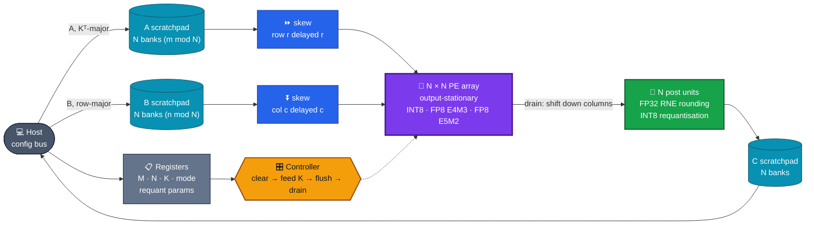
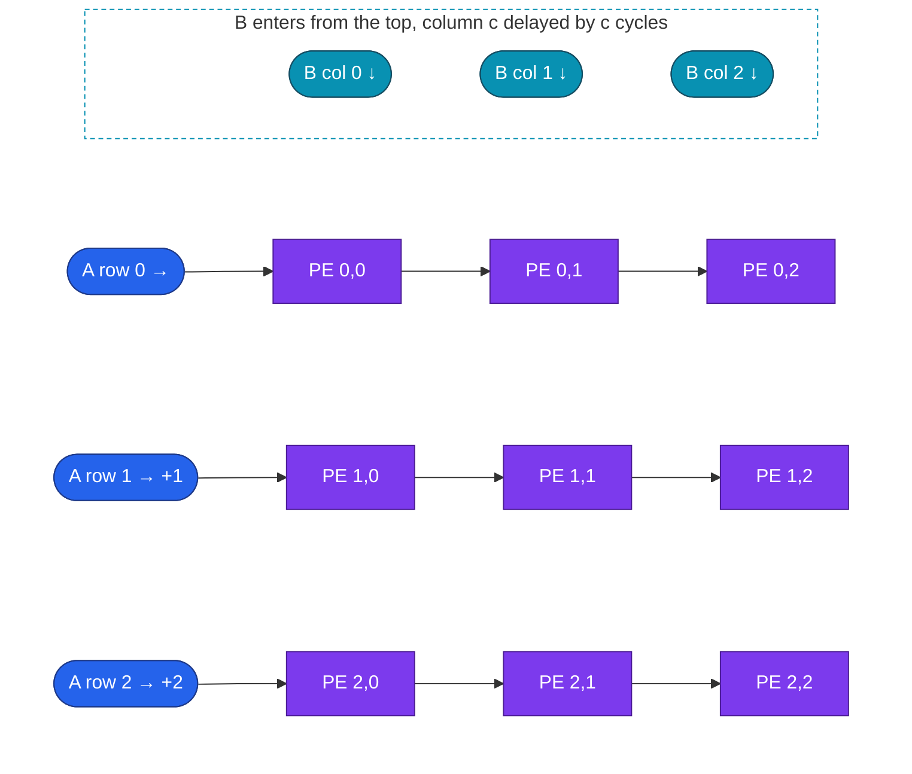
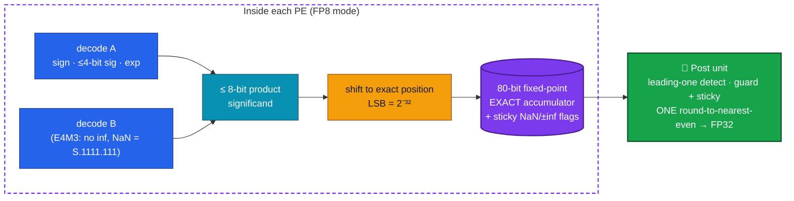
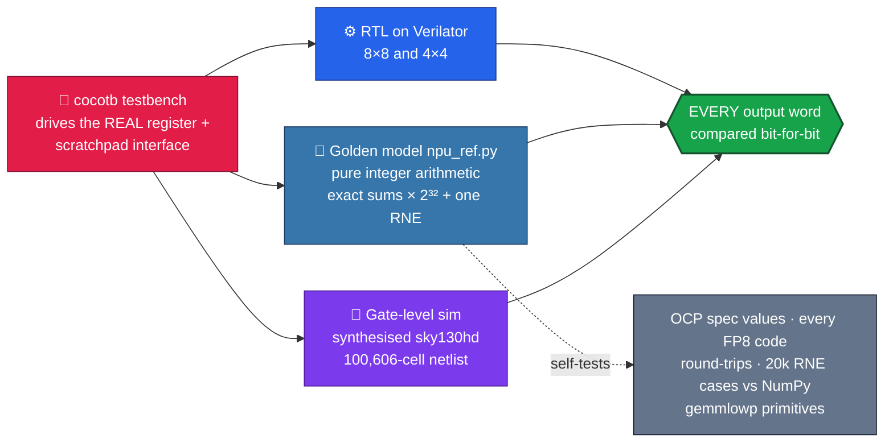
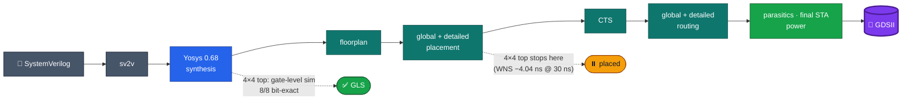
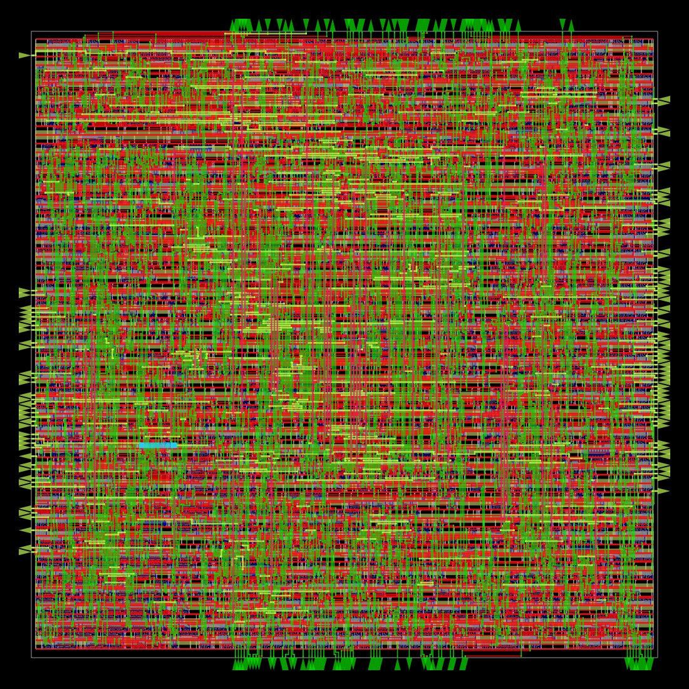
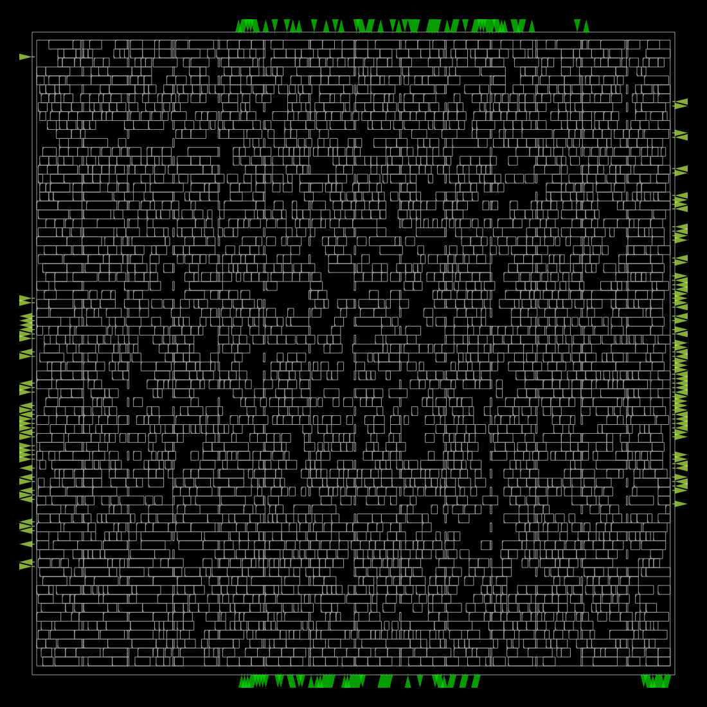

<div align="center">

# 🧮 INT8 / FP8 Systolic GEMM Accelerator

### A parameterisable N×N output-stationary systolic array in SystemVerilog for AI-inference matrix multiply, with exact FP8 accumulation, bit-exact verification, and a PE taken all the way to routed GDSII on sky130

**INT8 (TFLite/gemmlowp requantisation) · FP8 E4M3 · FP8 E5M2 (OCP OFP8) · correctly-rounded FP32 output**

<br/>


-16a34a?style=flat-square)
-0891b2?style=flat-square)


[**Architecture**](#%EF%B8%8F-architecture) · [**Exact FP8**](#-why-exact-fp8-accumulation) · [**Verification**](#-verification) · [**Performance**](#-performance) · [**Physical design**](#-physical-design-rtl--gdsii) · [**Run it**](#-running-it)

</div>

---

## 📌 TL;DR

| | |
|---|---|
| 🧱 **Architecture** | N×N **output-stationary** systolic array · banked A/B/C scratchpads · skew networks · per-column post units · register-mapped controller |
| 🔢 **INT8 mode** | INT32 accumulation, then **TFLite/gemmlowp requantisation** (bias, `SaturatingRoundingDoublingHighMul`, `RoundingDivideByPOT`, zero point, clamp, ReLU), bit-identical to the reference |
| 🌗 **FP8 modes** | OCP OFP8 **E4M3** and **E5M2**, including subnormals, NaN/inf rules · products land in an **80-bit exact fixed-point accumulator** and are rounded **once** to FP32 (RNE) |
| 🎯 **Result** | FP8 GEMMs are **correctly rounded and independent of summation order**: ≤ 0.5 ULP, vs 32 ULP for FP32 accumulation and 26% error or overflow for FP16 |
| ✅ **Verified** | Every output word compared **bit for bit** with a Python golden model (cocotb + Verilator), on 8×8 and 4×4 arrays, and in **gate-level simulation** of the synthesised 100k-cell netlist |
| 🔬 **Silicon flow** | OpenROAD-flow-scripts on sky130hd + nangate45: **PE taken to routed GDSII** with STA and a clock sweep; full 4×4 top synthesised and placed |

---

## 🏗️ Architecture



### Output-stationary dataflow



<sub>A values flow right and B values flow down, one PE per cycle. With rows and columns skewed by r and c cycles, A[r][k] and B[k][c] meet in PE (r, c) at cycle k + r + c. Each PE owns one output element of the current N×N tile.</sub>

### Tile schedule (8×8 array, K = 256)

```mermaid
gantt
    title Cycles per tile = K + 3N + 3 (8×8, K = 256)
    dateFormat X
    axisFormat %s
    section Tile
    clear (1)          :done, c1, 0, 1s
    feed K (256)       :active, f1, after c1, 256s
    flush 2N+1 (17)    :crit, fl, after f1, 17s
    drain N (8)        :d1, after fl, 8s
    next (1)           :n1, after d1, 1s
```



<sub>Utilisation = K / (K + 3N + 3) = **90.5%** for 8×8 at K = 256 and **94.5%** for 4×4. Double-buffered accumulators that overlap drain with the next tile's feed are the documented next step.</sub>

---

## 🎯 Why exact FP8 accumulation?



The smallest E5M2 product is 2⁻³², and the largest possible sum (2³¹·⁸ × 4,096) fits in 80 bits, so **no bit of the dot product is ever lost**. Rounding happens exactly once, at the end.

| Accumulation, 32×256×32 GEMM | E4M3 max error | E5M2 max error |
|---|:---:|:---:|
| **Exact + one FP32 rounding (this design)** | **0.5 ULP** | **0.5 ULP** |
| Sequential FP32 | 32 ULP | 8 ULP |
| Sequential FP16 | 26% relative error | **overflow** |

**The trade-off, measured:** exact accumulation makes an FP8-capable PE **3.5× larger** than an INT8-only PE in sky130hd (24,642 vs 7,046 µm²). On ECP5 the LUT ratio looks like 21×, because the INT8 multiplier maps to a DSP block and the 80-bit shifter and adder don't. The README reports both figures and explains the difference.

---

## ✅ Verification



| Test | Covers |
|---|---|
| `int8_random_shapes` | 8×8×8, 1×1×1, 13×21×37, 3×64×5, 64×2×17, 9×9×200: partial tiles in both dimensions, K = 1 |
| `int8_extremes_and_bias` | −128 × −128 over K = 256 · bias near INT32_MAX wrapping |
| `int8_requantisation` | 6 random multiplier / shift / zero-point / ReLU / bias configurations |
| `fp8_e4m3_random` | random E4M3 incl. subnormals, up to 16×16×256 · NaN inputs |
| `fp8_e5m2_random_and_specials` | inf, NaN, inf × 0, +inf + −inf |
| `fp8_exact_accumulation_and_ties` | (2¹⁵ + 1) − 2¹⁵ = 1 **exactly** · 1 + 2⁻²⁴ ties to even · 1.25 + 2⁻²⁴ rounds up |
| `bad_dimensions_set_error` | illegal M/K/mode raise the error bit, and the accelerator still works afterwards |
| `cycle_counts_match_the_schedule` | **K + 3N + 3 per tile, cycle-exact** |

All 8 tests run on both array sizes. `verilator --lint-only -Wall` is clean, and ORFS's formal equivalence check reports the final routed FP8 PE netlist **IDENTICAL** to the synthesised one.

---

## 📈 Performance

| Array | GEMM (M×N×K) | Cycles | MAC utilisation |
|---|:---:|:---:|:---:|
| 8×8 | 8×8×256 | 283 | **90.5%** |
| 8×8 | 64×64×256 | 18,112 | **90.5%** |
| 8×8 | 16×16×64 | 364 | 70.3% |
| 4×4 | 4×4×256 | 271 | **94.5%** |
| 4×4 | 64×64×256 | 69,376 | **94.5%** |

<sub>INT8 and FP8 have identical cycle counts. Throughput = N² · f · utilisation MAC/s. All numbers come from cycle-exact RTL simulation.</sub>

---

## 🔬 Physical design: RTL → GDSII



<table>
<tr>
<td width="50%" align="center"><br/><sub><b>Routed INT8 + FP8 PE</b> · sky130hd · 10 ns · 0 DRC violations</sub></td>
<td width="50%" align="center"><br/><sub><b>Final placement</b> · 24,642 µm² · 67% utilisation</sub></td>
</tr>
</table>

### PE clock sweep, sky130hd typical (full flow per point)

| PE | Period | Cell area | Setup WNS | Hold WNS | Route DRC | Power | Closes |
|---|:---:|:---:|:---:|:---:|:---:|:---:|:---:|
| INT8 only | 10 ns | 7,046 µm² | +1.19 ns | +0.50 ns | 0 | 1.48 mW | ✅ |
| INT8 only | **8 ns** | 7,965 µm² | +0.26 ns | +0.49 ns | 0 | 2.37 mW | ✅ **125 MHz** |
| INT8 only | 7 ns | 8,444 µm² | −0.17 ns | +0.49 ns | 0 | 2.86 mW | ❌ |
| INT8 + FP8 | **10 ns** | 24,642 µm² | +0.24 ns | +0.58 ns | 0 | 9.69 mW | ✅ **100 MHz** |
| INT8 + FP8 | 9 ns | 26,542 µm² | −0.35 ns | +0.58 ns | 0 | 11.93 mW | ❌ |

### Full 4×4 top level (sky130hd)

| Stage | Status | Result |
|---|:---:|---|
| Synthesis | ✅ | **100,606 cells**, 863,408 µm² (20% sequential) |
| Gate-level simulation of the synthesised netlist | ✅ | **8/8 tests bit-exact** |
| Floorplan + placement | ✅ | 1.913 mm² core, 49.3% utilisation |
| Timing after placement | ⚠️ | WNS −4.04 ns at 30 ns, so about **29–30 MHz** (pre-CTS estimate) |
| CTS · routing · sign-off · GDSII | ❌ | runs were killed by worker restarts on a shared machine |

**Critical path:** tile counter → bias index → combinational INT32 add + **32×32 requantisation multiplier** in `npu_post` → C scratchpad. Pipelining the post unit is the clear fix. Details: [`physical_design.md`](docs/physical_design.md) · flow: [`flow/README.md`](flow/README.md)

---

## 🚀 Running it

```bash
python3 -m venv .venv && .venv/bin/pip install cocotb==1.9.2 numpy pytest   # cocotb 2.x needs Verilator ≥ 5.036
PATH=$PWD/.venv/bin:$PATH make lint model-test test test-n4      # lint, golden model, 8×8 + 4×4 suites
make test-small                                                    # the 4×4 configuration built by the ASIC flow
make accuracy synth && python3 bench/report.py                     # FP8 accuracy study, area, docs/benchmarks.md
```

The register map is documented at the top of [`rtl/npu_top.sv`](rtl/npu_top.sv). The physical-design flow runs OpenROAD-flow-scripts in Docker ([`flow/README.md`](flow/README.md)), and gate-level simulation uses [`flow/scripts/gls.sh`](flow/scripts/gls.sh).

---

## ⚠️ Limitations

- **Partial, academic physical design.** Only the PE is routed to GDS; the 4×4 top stops at placement. There's one typical corner, vectorless power, and no KLayout DRC/LVS, tape-out or silicon.
- **The top-level clock is slow** (about 30 MHz), limited by the un-pipelined post unit. The default 48 KiB scratchpads would need SRAM macros.
- **Exact FP8 costs area** (3.5× per PE in sky130hd). A cheaper FP32-window PE wasn't built for comparison.
- **No drain/compute overlap** (3N + 3 cycles per tile). There's no DMA or AXI; the host writes scratchpads word by word.
- **Limits:** M, N ≤ 64 and K ≤ 256 per run (larger GEMMs are tiled by the host). Per-tensor requantisation only; FP8 outputs are raw FP32.
- **Simulation and open-PDK only.** No FPGA bring-up, no formal equivalence against the golden model, and no coverage metric.

Full list: [`limitations.md`](docs/limitations.md) · Architecture: [`architecture.md`](docs/architecture.md) · Benchmarks: [`benchmarks.md`](docs/benchmarks.md) · Testing: [`testing.md`](docs/testing.md)

---

## 📁 Repository layout

```text
INT8-FP8-ACCELARATOR/
├── rtl/       ⚙️  npu_pe.sv (PE) · npu_post.sv (FP32 rounding, requantisation) · npu_top.sv (array, scratchpads, controller)
├── model/     🐍  npu_ref.py bit-exact golden model + self-tests
├── tb/        🧪  cocotb testbenches (full + small/GLS configuration)
├── bench/     📊  FP8 accuracy study, perf results, report generator
├── synth/     🧱  Yosys area script + results
├── flow/      🔬  OpenROAD-flow-scripts configs (sky130hd, nangate45), GLS script, results + layout images
└── docs/      📖  architecture · physical design · benchmarks · testing · limitations
```

---

<div align="center">

**Every output word bit-exact. Every FP8 sum exact. One rounding, at the very end.**

<br/>

Built by **[Siddhant Singh](https://github.com/siddhaantxsingh)** · B.Tech ECE (VLSI Design & Technology), MIT Manipal · <sub>MIT License</sub>

</div>
